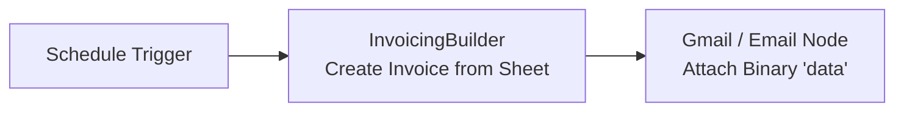
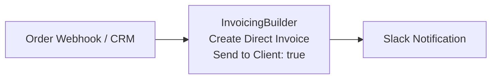

# n8n-nodes-invoicingbuilder

[](https://www.npmjs.com/package/n8n-nodes-invoicingbuilder)
[](https://opensource.org/licenses/MIT)

This is an official n8n community node for [InvoicingBuilder](https://invoicingbuilder.com). It enables you to create and render pixel-perfect invoices (PDF and PNG) from Google Sheets or direct workflow data, manage clients, dispatch automated payment reminders, and run aggregate financial reports and trend analyses directly inside your n8n workflows.

[n8n](https://n8n.io/) is a fair-code licensed workflow automation platform.

---

## Table of Contents

- [Features](#features)
- [Installation](#installation)
- [Credentials](#credentials)
- [Resources and Operations](#resources-and-operations)
  - [1. Invoice Resource](#1-invoice-resource)
    - [Create Invoice (Google Sheets Source)](#create-invoice-google-sheets-source)
    - [Create Invoice (Direct Input Source)](#create-invoice-direct-input-source)
    - [Delete Invoice](#delete-invoice)
    - [Download Invoice](#download-invoice)
    - [Get Invoice](#get-invoice)
  - [2. Client Resource](#2-client-resource)
    - [Create Client](#create-client)
    - [Update Client](#update-client)
    - [Get Client](#get-client)
    - [Get Many Clients](#get-many-clients)
    - [Delete Client](#delete-client)
    - [Send Payment Reminder](#send-payment-reminder)
  - [3. Report Resource](#3-report-resource)
    - [Summary Report](#summary-report)
    - [Analyse Trends](#analyse-trends)
- [Dynamic Resource Locators & Pagination](#dynamic-resource-locators--pagination)
- [Execution Limits](#execution-limits)
- [Example Workflows](#example-workflows)
  - [Workflow A: Automated Billing from Google Sheets to Email](#workflow-a-automated-billing-from-google-sheets-to-email)
  - [Workflow B: Direct Workflow Data to Client Invoicing with Email Dispatch](#workflow-b-direct-workflow-data-to-client-invoicing-with-email-dispatch)
  - [Workflow C: Automated Overdue Payment Reminders](#workflow-c-automated-overdue-payment-reminders)
- [Error Handling](#error-handling)
- [Development and Testing](#development-and-testing)
- [License](#license)

---

## Features

- **Multi-Source Invoice Generation**: Render invoices using **Google Sheets** (auto-detection of columns & line items) or **Direct Input / Workflow Data** (dynamic mapping from upstream nodes).
- **Template-Driven Rendering**: Automatically fetches account templates with live pagination and search; clears stale designer placeholder data before rendering.
- **Client Management**: Create, update, fetch, list, and delete clients with dynamic field mapping via n8n's Resource Mapper.
- **Direct Client Emailing**: Toggle `Send to Client` to automatically dispatch rendered invoices to the client's email via InvoicingBuilder.
- **Automated Payment Reminders**: Trigger one-click payment reminder emails to clients for overdue accounts.
- **Financial Analytics**: Generate currency-grouped summary reports and periodic trend analyses, with an option to email reports directly to the account owner (`Send to User`).
- **Flexible File Formats**: Generate and download rendered invoices as single PDF or PNG files, or bundled ZIP archives.
- **Lazy Loading & Search**: Full pagination support for templates, clients, and invoice dropdowns across large datasets.

---

## Installation

### Community Nodes (Recommended)
1. In your n8n instance, navigate to **Settings > Community Nodes**.
2. Click **Install**.
3. Enter `n8n-nodes-invoicingbuilder` in the **npm package name** field.
4. Agree to the risks of installing community nodes and click **Install**.

### Self-Hosted / Docker
Install the package directly into your n8n root or custom extensions directory:
```bash
npm install n8n-nodes-invoicingbuilder
```

Restart your n8n instance to activate the node.

---

## Credentials

To authenticate requests to the InvoicingBuilder API, configure an **InvoicingBuilder API** credential in n8n.

### Required Fields:
- **API Key**: Your InvoicingBuilder API key (starts with `ib_`). Generate your key from the InvoicingBuilder dashboard under **Developer Settings**.

---

## Resources and Operations

The **InvoicingBuilder** node provides three primary resources: **Invoice**, **Client**, and **Report**.

```text
InvoicingBuilder Node
├── Invoice
│   ├── Create       (From Google Sheet or Direct Workflow Data)
│   ├── Delete       (Remove a past invoice from account history)
│   ├── Download     (Retrieve rendered PDF/PNG binary by ID)
│   └── Get          (Fetch invoice details and totals by ID)
├── Client
│   ├── Create       (Add new client with billing/shipping info)
│   ├── Update       (Update client via dynamic Resource Mapper)
│   ├── Get          (Retrieve client details by ID)
│   ├── Get Many     (List all clients or apply limit)
│   ├── Delete       (Remove client record)
│   └── Send Reminder(Email payment reminder to client)
└── Report
    ├── Summary      (Aggregate metrics & monthly revenue by currency)
    └── Analyse Trends(Periodic growth & deltas by currency)
```

---

### 1. Invoice Resource

#### Create Invoice

Renders branded invoice documents and stores them in InvoicingBuilder history. You can select between two data sources:

##### Create Invoice (Google Sheets Source)
Reads rows directly from a spreadsheet tab, groups line items by invoice, and builds invoices automatically:

- **Template Name or ID**: Choose a template from your account (searchable dropdown with pagination) or supply an ID.
- **Data Source**: Set to `Google Sheet`.
- **Google Spreadsheet**: Provide the Google Spreadsheet URL or Spreadsheet ID.
- **Worksheet / Sheet Name**: Name or ID of the worksheet tab (defaults to `Sheet1`).
- **Format**: `PDF` (default) or `PNG`.
- **Send to Client**: When enabled (`true`), automatically emails the generated invoice PDF/PNG to the recipient email detected from the sheet.

**How Google Sheets Mapping Works:**
- **Auto-Grouping**: The node automatically identifies the invoice identifier column (e.g. `Invoice Number`, `Order ID`, `Customer Name`) to group multiple line-item rows into separate invoices.
- **Auto-Detection**: Standard columns (`Description`, `Quantity`, `Rate`, `Tax`, `Amount`, `Bill To`, `Due Date`, `Date`, etc.) are detected automatically without manual mapping.
- **Placeholder Clearing**: All placeholder fields from the designer template are cleared prior to population, preventing default dummy data from leaking into the output.

##### Create Invoice (Direct Input Source)
Map data directly from incoming workflow items (webhooks, CRMs, databases, Stripe, etc.) without requiring a spreadsheet:

- **Template Name or ID**: Choose a template from your account.
- **Data Source**: Set to `Direct Input / Workflow Data`.
- **Client Name or ID**: Select a client from your InvoicingBuilder account (searchable with pagination) or pass a Client ID. The node automatically retrieves the client's `Name`, `Email`, `Bill To`, and `Ship To` details.
- **Invoice Number**: Custom invoice number (e.g. `INV-2026-001`). If blank, the template default is preserved.
- **PO Number**: Optional Purchase Order number.
- **Invoice Date**: Issue date in UTC (`YYYY-MM-DD`).
- **Due Date**: Payment due date in UTC (`YYYY-MM-DD`).
- **Line Items**: Add line items with:
  - `Description`: Item or service description (required).
  - `Quantity`: Number of units (default: `1`).
  - `Rate / Price`: Price per unit.
  - `Tax (%)`: Optional tax rate percentage (e.g. `10` or `10%`).
  - `Amount`: Total amount (optional; calculated automatically as `Quantity * Rate + Tax` if left blank).
  - *Dynamic mapping*: Incoming items containing `lineItems` or `items` arrays are mapped automatically.
- **Additional Fields**:
  - `Amount Paid`: Existing payments applied to the invoice.
  - `Notes`: Custom notes displayed on the invoice.
  - `Terms & Conditions`: Custom legal or contract terms.
  - `Payment Terms`: e.g. `Net 30`, `Due on Receipt`.
  - `Logo (URL or Base64)`: Override the template logo with a custom image URL or base64 data URI.
  - `Signature (URL or Base64)`: Override the template signature.
  - `Custom Fields (JSON)`: Raw JSON key-value pairs for advanced template customization.
- **Format**: `PDF` (default) or `PNG`.
- **Send to Client**: When enabled (`true`), emails the rendered invoice directly to the client's billing email.

##### Invoice Create Output
- **Binary Property**: Rendered file returned in `data`:
  - **1 Invoice**: Returns `invoice.pdf` or `invoice.png`.
  - **2 Invoices**: Returns a zip archive `invoices.zip` containing both invoices.
- **JSON Metadata**:
  ```json
  {
    "success": true,
    "invoiceCount": 1,
    "format": "pdf",
    "fileName": "invoice.pdf",
    "source": "direct",
    "invoiceIds": ["inv_987654321"],
    "sendToClient": true,
    "emailedTo": ["billing@acme.com"]
  }
  ```

---

#### Download Invoice
Downloads a previously rendered and saved invoice as a binary file:

- **Invoice Name or ID**: Select an invoice from your account history (searchable with pagination) or provide an invoice ID.
- **Download Format**: `PDF` (default) or `PNG`.
- **Output**: Writes the binary file to `data` and outputs metadata (`success`, `invoiceId`, `format`, `fileName`).

---

#### Get Invoice
Fetches metadata, calculation totals, line items, and current payment status of an existing invoice:

- **Invoice Name or ID**: Select an invoice from your account history or provide an invoice ID.
- **Output**: Complete invoice JSON object including subtotal, taxes, balance due, and client details.

---

#### Delete Invoice
Deletes a past invoice and its associated reminders from your InvoicingBuilder account history:

- **Invoice Name or ID**: Select an invoice from your account history (searchable with pagination) or provide an invoice ID.
- **Output**: Confirmation JSON (`success: true`, `message`, `invoiceId`).

---

### 2. Client Resource

Manage your client directory directly within your workflows.

#### Create Client
Creates a new client in InvoicingBuilder:
- **Name**: Client or company name (required).
- **Email**: Primary billing email address.
- **Bill To**: Default billing address and contact notes.
- **Ship To**: Default shipping or delivery address.

#### Update Client
Updates an existing client using n8n's visual **Resource Mapper**:
- **Client Name or ID**: Select the client to update.
- **Update Fields**: Use the visual field mapper to update any subset of properties (`Name`, `Email`, `Bill To`, `Ship To`). Only modified fields are submitted to the API.

#### Get Client
Retrieves details for a specific client:
- **Client Name or ID**: Select or provide the client ID.

#### Get Many Clients
Lists clients in your account:
- **Return All**: Toggle to retrieve all clients (`true`) or specify a maximum count.
- **Limit**: Maximum number of clients to return (default: `50`).

#### Delete Client
Deletes a client record from InvoicingBuilder:
- **Client Name or ID**: Select or provide the client ID.

#### Send Payment Reminder
Dispatches an automated payment reminder email to the client for an outstanding or unpaid invoice:
- **Client Name or ID**: Select or provide the client ID.
- **Invoice Name or ID**: Select from a dynamic dropdown showing only invoices belonging to the chosen client (searchable with pagination) or provide an invoice ID.
- **Output**: Status confirmation of the sent reminder email, recipient, and invoice details.

---

### 3. Report Resource

Generate aggregate financial summaries and trend analyses across your billing history.

#### Summary Report
Fetches high-level invoice statistics and zero-filled monthly breakdowns grouped by currency:

- **From**: Optional UTC start date (`YYYY-MM-DD`).
- **To**: Optional UTC end date (`YYYY-MM-DD`). The node validates that `From <= To`.
- **Status**: Filter by invoice status (`All`, `Paid`, `Unpaid`, `Overdue`).
- **Send to User**: When enabled (`true`), emails the complete summary report to the authenticated user's email address in the background without blocking workflow execution.
- **Output**: JSON object with separate totals and monthly breakdowns per currency (currencies are never summed together).

#### Analyse Trends
Fetches historical growth series with period-over-period percentage and absolute changes grouped by currency:

- **Period**: Aggregation interval (`Monthly`, `Quarterly`, `Yearly`).
- **Number of Periods**: Number of historical periods to include (2–36). Defaults: `12` (monthly), `8` (quarterly), `5` (yearly).
- **End Date**: Optional anchor end date (`YYYY-MM-DD`). The series ends with the period containing this date (final period may have `isPartial: true`).
- **Send to User**: When enabled (`true`), emails the trend analysis report to the authenticated user's email address.
- **Output**: Periodic timeline arrays containing revenue, count, and period-over-period delta percentages per currency.

> **Backward Compatibility**: `generateReport` and `analyseTrends` remain accessible under the `Invoice` resource for existing workflows.

---

## Dynamic Resource Locators & Pagination

All dropdowns for selecting entities (**Template**, **Client**, and **Invoice**) use n8n's **Resource Locator** pattern:

- **From List (Search & Lazy Loading)**: As you type or scroll, the node requests paginated data from InvoicingBuilder (`searchTemplates`, `searchClients`, `searchInvoices`). This allows seamless selection across hundreds of records without hitting memory or payload limits.
- **By ID**: Switch to **ID** mode to pass static IDs or dynamic n8n expressions (e.g. `={{ $json.clientId }}`).

---

## Execution Limits

To ensure optimal rendering performance and prevent memory spikes during document generation, the InvoicingBuilder API processes **up to 2 invoices per request**:

- **1 Invoice**: Rendered as a single PDF or PNG binary file.
- **2 Invoices**: Rendered and bundled into a single `invoices.zip` archive.
- **Batches > 2 Invoices**: The node safely processes the **first 2 invoices** in the dataset and ignores excess items. To process larger datasets, use n8n's **Loop Over Items** or **Split In Batches** node with a batch size of `2`.

---

## Example Workflows

### Workflow A: Automated Billing from Google Sheets to Email

Generate invoices from a shared Google Sheet and attach the rendered PDF to an outgoing email.



1. **Schedule Trigger**: Triggers weekly or on demand.
2. **InvoicingBuilder**:
   - Resource: `Invoice` | Operation: `Create`
   - Data Source: `Google Sheet`
   - Spreadsheet: `https://docs.google.com/spreadsheets/d/.../edit`
   - Worksheet: `Sheet1`
   - Format: `PDF`
3. **Gmail Node**:
   - Attachments: Binary property `data`
   - Subject: `Your Invoices are ready`

---

### Workflow B: Direct Workflow Data to Client Invoicing with Email Dispatch

Receive an order webhook, fetch client details, render an invoice, and email it directly to the customer.



1. **Webhook**: Receives order data `{ orderId: "ORD-99", items: [...], clientId: "cl_123" }`.
2. **InvoicingBuilder**:
   - Resource: `Invoice` | Operation: `Create`
   - Data Source: `Direct Input / Workflow Data`
   - Client Name or ID: `={{ $json.clientId }}`
   - Invoice Number: `={{ $json.orderId }}`
   - Send to Client: `true`
3. **Slack**: Posts a message confirming invoice generation and email dispatch.

---

### Workflow C: Automated Overdue Payment Reminders

Find clients with overdue invoices and trigger automated email reminders.


1. **Cron Trigger**: Runs daily at 9:00 AM.
2. **InvoicingBuilder (Report)**: Fetches summary of overdue invoices.
3. **InvoicingBuilder (Client)**: Triggers `Send Reminder` for clients with pending balances.

---

## Error Handling

- **401 Unauthorized**: Mapped to `Invalid, revoked or expired API key`.
- **429 Rate Limit**: Automatically extracts the server's `retryAfter` delay so n8n's **Retry On Fail** handles exponential backoff cleanly.
- **400 / 404 Validation Errors**: Returns precise backend validation messages.
- **Continue on Fail**: Fully supported across all resources and operations. When enabled in node settings, errors output `{ "error": "message" }` with paired item indexing to keep workflows running smoothly.

---

## Development and Testing

### Prerequisites
- Node.js 18.x or 20.x
- npm 9.x+

### Build
Compile the TypeScript code:
```bash
npm run build
```

### Development Watch Mode
```bash
npm run dev
```

### Linting
```bash
npm run lint
npm run lint:fix
```

### Running Tests
Execute the complete test suite with Vitest:
```bash
npm test
```

Unit and integration tests cover:
- Dynamic Google Sheet CSV parsing and row grouping (`groupRows`).
- Automatic template dummy field clearing and field matching (`buildInvoiceFields`).
- Direct invoice building with client integration and line items (`buildDirectInvoice`).
- Dynamic resource locator searches and pagination for templates, clients, and invoices.
- Client CRUD operations, dynamic resource mapping, and payment reminders.
- Report summaries, trends series, and date validation.
- Mock HTTP test suites covering error codes (400, 401, 404, 429).

---

## License

[MIT](LICENSE)
