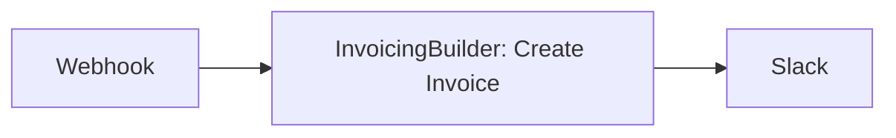
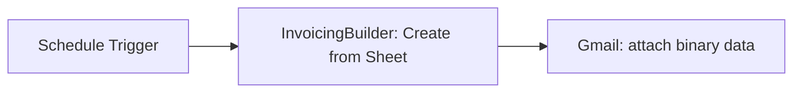
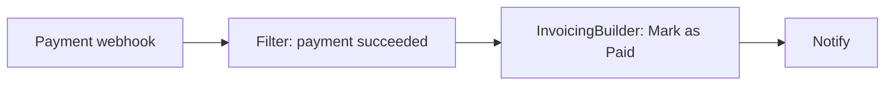
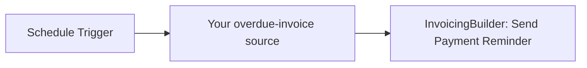

# n8n-nodes-invoicingbuilder

[](https://www.npmjs.com/package/n8n-nodes-invoicingbuilder)
[](LICENSE)

An [n8n](https://n8n.io/) community node for [InvoicingBuilder](https://invoicingbuilder.com). Create invoices from workflow data or Google Sheets, manage clients, update payment status, send payment reminders, download rendered invoices, and pull financial reports, all from your n8n workflows.

n8n is a [fair-code licensed](https://docs.n8n.io/sustainable-use-license/) workflow automation platform.

> **Before you automate:** several operations are hard to undo (deleting records, emailing clients, changing payment status). Read [Operations with side effects](#operations-with-side-effects) and test against non-production data first.

## Table of contents

- [Installation](#installation)
- [Quick start](#quick-start)
- [Credentials](#credentials)
- [Compatibility](#compatibility)
- [Operations](#operations)
  - [Invoice](#invoice)
  - [Client](#client)
  - [Report](#report)
- [Operations with side effects](#operations-with-side-effects)
- [Limits](#limits)
- [Using the node as an AI Agent tool](#using-the-node-as-an-ai-agent-tool)
- [Example workflows](#example-workflows)
- [Troubleshooting](#troubleshooting)
- [Resources](#resources)
- [License](#license)

## Installation

Follow the [n8n community nodes installation guide](https://docs.n8n.io/integrations/community-nodes/installation/).

**Self-hosted n8n (UI):** open **Settings → Community Nodes → Install**, enter `n8n-nodes-invoicingbuilder`, accept the risk notice, and install.

**Self-hosted n8n (manual):** install into your n8n custom nodes directory, then restart n8n.

```bash
mkdir -p ~/.n8n/nodes
cd ~/.n8n/nodes
npm install n8n-nodes-invoicingbuilder
```

Docker and queue-mode setups differ. Make sure the package is installed where every n8n process that runs workflows can load it. See the [manual installation guide](https://docs.n8n.io/integrations/community-nodes/installation/manual-installation/).

**n8n Cloud:** community nodes are available on Cloud only after n8n has verified them. If this node does not appear in the nodes panel, verified community nodes may be disabled by your instance owner, or this package may not be verified yet.

Community nodes run with the same access as n8n itself. Install only packages whose source you trust.

## Quick start

1. Create an **InvoicingBuilder API** credential (see [Credentials](#credentials)).
2. Add the **InvoicingBuilder** node to a workflow and select the credential.
3. Run a read-only operation first, such as **Client → Get Many**, and confirm the output.
4. Only then enable operations that send email, change payment status, or delete data.

## Credentials

Create an **InvoicingBuilder API** credential with:

| Field   | Required | Description                                                                                                             |
| ------- | -------- | ----------------------------------------------------------------------------------------------------------------------- |
| API Key | Yes      | Generate it under **API Keys** in your [InvoicingBuilder](https://invoicingbuilder.com) account. Keys start with `ib_`. |

When you save the credential, n8n tests it against the InvoicingBuilder API (`/api/v1/auth`).

Credential safety:

- Keep the key in the n8n credential only. Never put it in node parameters, expressions, workflow JSON, screenshots, or logs.
- If a key is exposed, revoke it in InvoicingBuilder and create a new one.
- Use an account and key with only the access your workflows need.

## Compatibility

<!-- VERIFY BEFORE PUBLISHING: fill in the real minimum n8n version and the versions you tested. -->

| Item                | Value              |
| ------------------- | ------------------ |
| Minimum n8n version | 1.86.4             |
| Tested n8n versions | 1.86.4             |
| Node.js             | 24.x               |

## Operations

The **InvoicingBuilder** node has three resources.

| Resource    | Operations                                                   |
| ----------- | ------------------------------------------------------------ |
| **Invoice** | Create, Download, Get, Mark as Paid, Delete                  |
| **Client**  | Create, Update, Get, Get Many, Delete, Send Payment Reminder |
| **Report**  | Summary, Analyse Trends                                      |

Template, client, and invoice pickers support search and pagination, so they work on accounts with many records. Switch a picker to **ID** mode to pass a fixed ID or an expression such as `{{ $json.clientId }}`.

### Invoice

#### Create

Renders an invoice from one of your InvoicingBuilder templates and saves it to your invoice history.

Common parameters:

| Parameter      | Description                                                                                   |
| -------------- | --------------------------------------------------------------------------------------------- |
| Template       | Template from your account.                                                                   |
| Data Source    | `Direct Input / Workflow Data` or `Google Sheet`.                                             |
| Format         | `PDF` (default) or `PNG`.                                                                     |
| Send to Client | Emails the rendered invoice to the client. See [side effects](#operations-with-side-effects). |

**Data Source: Direct Input / Workflow Data**

Build the invoice from data in your workflow.

| Parameter               | Description                                                                                               |
| ----------------------- | --------------------------------------------------------------------------------------------------------- |
| Client                  | Select a client or pass a client ID. Name, email, Bill To, and Ship To are loaded from the client record. |
| Invoice Number          | For example `INV-2026-001`. If empty, the template default is kept.                                       |
| PO Number               | Optional.                                                                                                 |
| Invoice Date / Due Date | UTC dates in `YYYY-MM-DD`.                                                                                |
| Line Items              | See below.                                                                                                |

Line item fields:

| Field        | Description                                                                                                                                       |
| ------------ | ------------------------------------------------------------------------------------------------------------------------------------------------- |
| Description  | Required.                                                                                                                                         |
| Quantity     | Default `1`.                                                                                                                                      |
| Rate / Price | Price per unit.                                                                                                                                   |
| Tax (%)      | Optional percentage, for example `10` or `10%`.                                                                                                   |
| Amount       | Optional. If empty, it is calculated as `Quantity × Rate × (1 + Tax ÷ 100)`. <!-- VERIFY: confirm this matches the node's actual calculation. --> |

If you add no line items, incoming items that contain a `lineItems` or `items` array are mapped automatically.

Additional fields: Amount Paid, Notes, Terms & Conditions, Payment Terms (for example `Net 30`), Logo (URL or Base64), Signature (URL or Base64), and Custom Fields (JSON) for template-specific values.

**Data Source: Google Sheet**

Reads rows from a worksheet, groups rows into invoices, and renders them.

| Parameter          | Description                                 |
| ------------------ | ------------------------------------------- |
| Google Spreadsheet | Spreadsheet URL or ID.                      |
| Worksheet          | Worksheet name or ID. Defaults to `Sheet1`. |

<!-- VERIFY BEFORE PUBLISHING: document exactly how the sheet is accessed (public link? OAuth? fetched server-side by InvoicingBuilder?) and what permission the sheet needs. Users must know whether their billing data has to be publicly shared. -->

How rows are mapped:

- **Grouping:** rows are grouped into invoices using an identifier column such as `Invoice Number`, `Order ID`, or `Customer Name`. Consecutive rows with the same identifier become line items of one invoice and inherit its header values.
- **Detected columns:** `Invoice Number`, `Date`, `Due Date`, `PO Number`, `Payment Terms`, `Ship To`, `Bill To`, `Notes`, `Terms`, `Description`, `Quantity`, `Rate`, `Tax`, `Amount`.
- **Template placeholders:** placeholder values from the template designer are cleared before your data is applied, so sample data does not leak into the output.

> A sample sheet is in [`sample/sample_bulk_invoice.csv`](sample/sample_bulk_invoice.csv). Import it into Google Sheets to try this mode.

**Output**

- Binary property `data` containing the file: `invoice.pdf` or `invoice.png` for one invoice, `invoices.zip` for two.
- JSON metadata:

```json
{
	"success": true,
	"invoiceCount": 1,
	"format": "pdf",
	"fileName": "invoice.pdf",
	"source": "direct",
	"invoiceIds": ["inv_987654321"],
	"sendToClient": true,
	"emailedTo": ["billing@acme.com"]
}
```

See [Limits](#limits) for the two-invoice cap per execution.

#### Download

Downloads a saved invoice as a binary file.

| Parameter       | Description                              |
| --------------- | ---------------------------------------- |
| Invoice         | Select an invoice or pass an invoice ID. |
| Download Format | `PDF` (default) or `PNG`.                |

Output: binary property `data` plus `success`, `invoiceId`, `format`, and `fileName`.

#### Get

Returns an invoice's metadata, line items, totals (subtotal, taxes, balance due), and payment status (`isPaid`).

| Parameter | Description                              |
| --------- | ---------------------------------------- |
| Invoice   | Select an invoice or pass an invoice ID. |

#### Mark as Paid

Sets an invoice's payment status.

| Parameter | Description                                                                                                                    |
| --------- | ------------------------------------------------------------------------------------------------------------------------------ |
| Invoice   | Select an invoice or pass an invoice ID.                                                                                       |
| Status    | `Paid` (default): sets `isPaid: true` and `balanceDue` to `0.00`. `Unpaid`: sets `isPaid: false` and restores the balance due. |

Example output:

```json
{
	"success": true,
	"message": "Invoice marked as paid successfully.",
	"invoiceId": "inv_987654321",
	"isPaid": true,
	"balanceDue": "0.00"
}
```

#### Delete

Deletes an invoice and its associated reminders from your InvoicingBuilder history.

| Parameter | Description                              |
| --------- | ---------------------------------------- |
| Invoice   | Select an invoice or pass an invoice ID. |

Output: `success`, `message`, `invoiceId`.

### Client

| Operation                 | Parameters                                                       | Notes                                                                         |
| ------------------------- | ---------------------------------------------------------------- | ----------------------------------------------------------------------------- |
| **Create**                | Name (required), Email, Bill To, Ship To                         |                                                                               |
| **Update**                | Client; fields to change (`Name`, `Email`, `Bill To`, `Ship To`) | Only the fields you set are sent. Other fields are left unchanged.            |
| **Get**                   | Client                                                           |                                                                               |
| **Get Many**              | Return All, Limit (default `50`)                                 |                                                                               |
| **Delete**                | Client                                                           | See [side effects](#operations-with-side-effects).                            |
| **Send Payment Reminder** | Client, Invoice                                                  | The Invoice picker lists only the selected client's invoices. Sends an email. |

### Report

Reports group results by currency. Currencies are never summed together.

#### Summary

| Parameter    | Description                                                       |
| ------------ | ----------------------------------------------------------------- |
| From / To    | Optional UTC dates (`YYYY-MM-DD`). `From` must not be after `To`. |
| Status       | `All`, `Paid`, `Unpaid`, or `Overdue`.                            |
| Send to User | Also emails the report to the account owner.                      |

Output: totals and zero-filled monthly breakdowns per currency. Summary returns aggregates, not a list of invoices or clients.

#### Analyse Trends

| Parameter         | Description                                                                                                          |
| ----------------- | -------------------------------------------------------------------------------------------------------------------- |
| Period            | `Monthly`, `Quarterly`, or `Yearly`.                                                                                 |
| Number of Periods | 2 to 36. Defaults: 12 monthly, 8 quarterly, 5 yearly.                                                                |
| End Date          | Optional anchor date. The series ends with the period containing it, and the last period may have `isPartial: true`. |
| Send to User      | Also emails the report to the account owner.                                                                         |

Output: per-period revenue and invoice count, with period-over-period absolute and percentage change, per currency.

## Operations with side effects

| Operation                                | Effect                                             | Recommendation                                                                            |
| ---------------------------------------- | -------------------------------------------------- | ----------------------------------------------------------------------------------------- |
| Invoice → Delete                         | Permanently removes the invoice and its reminders. | Do not automate without a confirmation step.                                              |
| Client → Delete                          | Permanently removes the client record.             | Same as above.                                                                            |
| Invoice → Mark as Paid                   | Changes payment status and balance due.            | Verify the payment event before calling it (for example, validate the webhook signature). |
| Client → Send Payment Reminder           | Emails the client.                                 | Do not blindly retry. A retry can send a duplicate email.                                 |
| Invoice → Create with **Send to Client** | Emails the invoice to the client.                  | Test with a client record that uses your own email address.                               |
| Report with **Send to User**             | Emails the account owner.                          |                                                                                           |

If you enable n8n's **Retry On Fail** for any of these, make sure a repeated call is safe. A failed HTTP response does not always mean the action did not happen.

## Limits

**The InvoicingBuilder API renders at most 2 invoices per request.**

- With 1 invoice, you get a single PDF or PNG.
- With 2 invoices, you get one `invoices.zip`.
- With more than 2, **only the first 2 are processed and the rest are ignored.** Check `invoiceCount` in the output rather than assuming every input was invoiced.

How to handle larger volumes:

- **Direct Input:** use **Loop Over Items** (Split in Batches) with batch size `2`.
- **Google Sheet source:** the node reads the worksheet itself, so Loop Over Items cannot split its rows. For more than two invoices, read the sheet with n8n's Google Sheets node, group rows into invoices, and use **Direct Input** mode with a loop.

## Example workflows

### A. Order webhook to client invoice

Receive an order, create an invoice from workflow data, and email it to the client.



1. **Webhook** receives `{ "orderId": "ORD-99", "clientId": "cl_123", "items": [...] }`.
2. **InvoicingBuilder** with Resource `Invoice`, Operation `Create`, Data Source `Direct Input / Workflow Data`:
   - Client (ID mode): `{{ $json.body.clientId }}`
   - Invoice Number: `{{ $json.body.orderId }}`
   - Send to Client: `true`
3. **Slack** posts a confirmation.

Run it once with Send to Client off and inspect the output before enabling email.

### B. Create invoices from a Google Sheet and email the PDF

Handles up to two invoices per run. See [Limits](#limits).



1. **Schedule Trigger** runs weekly or on demand.
2. **InvoicingBuilder** with Resource `Invoice`, Operation `Create`, Data Source `Google Sheet`, your spreadsheet URL, Worksheet `Sheet1`, Format `PDF`.
3. **Gmail** (or any email node) sends the message with binary property `data` attached.

### C. Payment webhook to Mark as Paid



1. **Webhook** receives the payment provider's event. Your payment event must carry the InvoicingBuilder invoice ID, for example in `metadata.invoiceId`.
2. **If/Filter** continues only for successful payments, for example Stripe `payment_intent.succeeded`.
3. **InvoicingBuilder** with Resource `Invoice`, Operation `Mark as Paid`:
   - Invoice (ID mode): `{{ $json.body.data.object.metadata.invoiceId }}`
   - Status: `Paid`
4. **Notify** your finance team.

Verify the webhook signature before this step (for example, with Stripe's signing secret). Otherwise anyone who finds the webhook URL can mark invoices as paid.

### D. Scheduled payment reminders

The node has no operation that lists overdue invoices. **Report → Summary** with Status `Overdue` returns totals, not client or invoice IDs, so it cannot feed **Send Payment Reminder** directly. Take the overdue list from a system that already holds it.



1. **Schedule Trigger** runs daily.
2. **Your source**: a database, spreadsheet, or CRM node that returns `clientId` and `invoiceId` for each overdue invoice.
3. **InvoicingBuilder** with Resource `Client`, Operation `Send Payment Reminder`:
   - Client (ID mode): `{{ $json.clientId }}`
   - Invoice (ID mode): `{{ $json.invoiceId }}`

Record which reminders you sent, so a rerun does not email the same client twice.

## Troubleshooting

| Symptom                      | What to check                                                                                                                                                         |
| ---------------------------- | --------------------------------------------------------------------------------------------------------------------------------------------------------------------- |
| `401 Unauthorized`           | The API key is wrong, revoked, or not in the selected credential.                                                                                                     |
| `400` validation error       | Required fields, date format (`YYYY-MM-DD`), line item values, IDs, and the message returned by the API.                                                              |
| `404 Not Found`              | The client or invoice ID exists in the account tied to this API key.                                                                                                  |
| `429` rate limit             | Lower request frequency or batch size. The node reads the server's `retryAfter` value when provided. Be careful with automatic retries on operations that send email. |
| Node missing after install   | Check the install succeeded, check n8n logs, confirm the package is in the environment that runs n8n, and restart n8n.                                                |
| Fewer invoices than expected | The two-invoice cap. See [Limits](#limits).                                                                                                                           |
| Email not sent               | Recipient address, the **Send to Client** / **Send to User** option, and your InvoicingBuilder email and template settings.                                           |                                                                               |

With **Continue On Fail** enabled, a failed item returns an error object and the workflow continues. A successful execution does not prove every item succeeded, so inspect the output.

## Resources

- [InvoicingBuilder](https://invoicingbuilder.com)
- [n8n community nodes documentation](https://docs.n8n.io/integrations/community-nodes/)
- [Report an issue](https://github.com/REPLACE_WITH_ORG/n8n-nodes-invoicingbuilder/issues) <!-- VERIFY: replace with the real repository URL, matching package.json. -->

## Version history

See [CHANGELOG.md](CHANGELOG.md) or the GitHub releases page.

## License

[MIT](LICENSE)
